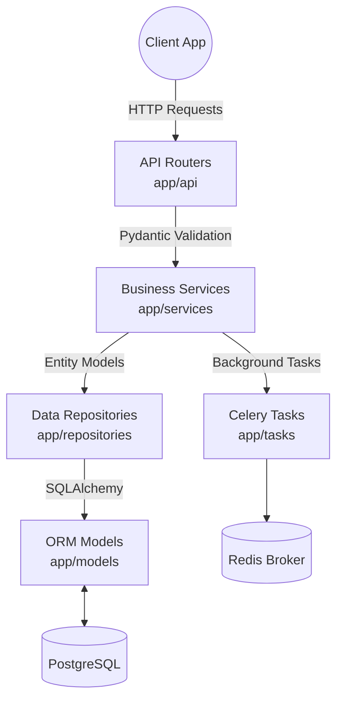

# Construction Internal Portal — Documentation Index

## Project Overview

Internal portal for a construction company to manage daily site reporting, project monitoring, inventory and stores, approvals, and cross-department communication. Designed as a scalable, modular, mobile-responsive web application.

Inventory & Stores is a Phase 2 capability for consumable materials and trackable tools/items. It supports multiple physical storage locations such as warehouses and project site stores, current-location visibility for asset-tagged tools, approval-controlled issue/transfer workflows, low-stock alerts by location, supplier context, and full movement history.

## Technology Stack

| Layer | Technology | Rationale |
|-------|-----------|-----------|
| **Frontend** | React 18 + TypeScript | Component reusability, strong typing, large ecosystem |
| **Styling** | Tailwind CSS | Utility-first, rapid UI development |
| **Backend** | FastAPI (Python 3.12+) | Async performance, auto OpenAPI docs, Pydantic V2 validation |
| **Database** | PostgreSQL 16 | ACID compliance, JSONB for flexible report fields, mature GIS support |
| **ORM** | SQLAlchemy 2.0 (async) | Full async support, Alembic for migrations |
| **Auth** | OAuth2 + JWT (python-jose) | Stateless auth with refresh tokens |
| **File Storage** | MinIO (S3-compatible) | Open source, self-hosted object storage |
| **Cache** | Redis | Session cache, rate limiting, background task queues |
| **Task Queue** | Celery + Redis broker | Async tasks (email, image processing, backups) |
| **Reverse Proxy** | Nginx | Static files, SSL termination, load balancing |
| **Container Runtime** | Docker + Docker Compose | Consistent dev/prod environments |
| **CI/CD** | GitHub Actions | Automated testing and build validation |
| **Monitoring** | Prometheus + Grafana (optional) | Health metrics and dashboards |

## Document Index

| # | Document | Description |
|---|----------|-------------|
| 1 | [Technical Specification](01_Technical_Specification.md) | Full system architecture, project structure, security model, deployment strategy |
| 2 | [Database Schema](02_Database_Schema.md) | PostgreSQL schema design, table definitions, indexes, relationships |
| 3 | [API Specification](03_API_Specification.md) | FastAPI endpoint catalog, request/response schemas, auth flows |
| 4 | [Work Breakdown Structure](04_Work_Breakdown_Structure.md) | Phase-based task breakdown with estimates and dependencies |
| 5 | [UI Component Tree](05_UI_Component_Tree.md) | React component hierarchy, state management, routing |
| 6 | [PostgreSQL Schema Reference](schema/README.md) | Codebase-derived database schema with one file per table and linked relations |
| 7 | [Operations Runbook](06_Operations_Runbook.md) | CI/CD, deployment approval, backup, restore, rollback, and alert procedures |
| 8 | [UAT And Launch Readiness](07_UAT_Launch_Readiness.md) | Seed data, stakeholder test scenarios, blocker classification, and sign-off checklist |
| 9 | [Architecture](ARCHITECTURE.md) | Codebase-derived architecture, layering rules, runtime boundaries, and deployment design |
| 10 | [Requirements Clarifications](REQUIREMENTS_QUESTIONS.md) | Stakeholder answers and remaining requirement follow-up items |
| 11 | [User Stories](user-stories/README.md) | Implementation-ready story files and build sequence |
| 12 | [Implementation Review](USER_STORY_IMPLEMENTATION_REVIEW.md) | Strict completion evidence and current partial/external evidence status |
| 13 | [Prototype Guide](PROTOTYPE.md) | Next.js requirements prototype structure, run commands, and stakeholder walkthrough map |
| 14 | [Deployment Environment](DEPLOYMENT_ENVIRONMENT.md) | Docker Compose production prerequisites, environment variables, and verification commands |
| 15 | [User Roles And Permissions](10_User_Roles_and_Permissions.md) | Current code-derived RBAC roles, permissions, frontend visibility, backend enforcement, and mismatch notes |

## Backend Architecture

The backend follows a layered architecture utilizing FastAPI, organizing concerns into discrete layers for maintainability and testing.



### Directory Structure

```text
backend/app/
├── api/          # FastAPI routers & endpoint handlers
├── middleware/   # Custom middlewares (CORS, metrics, logging)
├── models/       # SQLAlchemy ORM definitions
├── repositories/ # Data access layer for database queries
├── schemas/      # Pydantic models for Input/Output validation
├── services/     # Business logic orchestration
├── tasks/        # Celery async background tasks
└── utils/        # Shared helper utilities and exceptions
```

## Quick Start (Development)

```bash
# Clone repo
git clone <repo-url> && cd garrison-investments

# Start all services
docker-compose up -d

# Run migrations
docker-compose exec backend alembic upgrade head

# Seed sample data
docker-compose exec backend python scripts/seed.py

# Frontend dev server (localhost:3000)
cd frontend && npm install && npm run dev

# API docs (localhost:8000/docs)
open http://localhost:8000/docs
```
