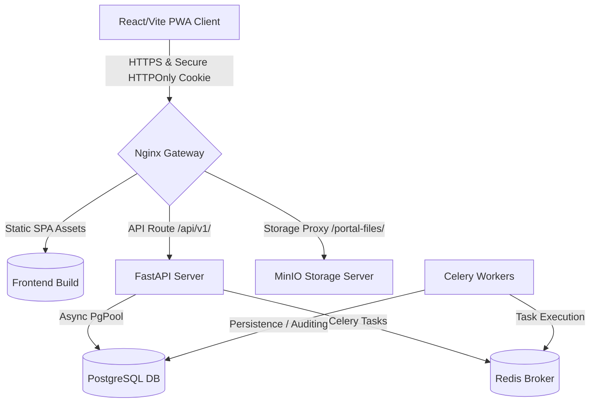

# Production Readiness Review (PRR)
**Project**: Construction Internal Portal (Garrison Investments)  
**Date**: July 27, 2026
**Status**: **Historical review from July 2026**

---

## 1. Executive Summary & Production Verdict

This review describes the state of the Construction Internal Portal in July 2026. Follow the current [deployment runbook](OPERATIONS_AND_DEPLOYMENT.md) for release evidence and approval.

All core functional workflows are backed by strict automated testing, database migrations are structured and backward-compatible, security controls follow strict industry best practices, and the recently resolved staging preview path ensures robust storage delivery.

---

## 2. Architectural & System Design Review

The application's architecture conforms exactly to a disciplined **Three-Tier Service-Repository Pattern** with asynchronous task processing.



### Architectural Highlights
1. **FastAPI & Asyncpg Integration**: Asynchronous SQLAlchemy 2.0 sessions are isolated per request lifecycle, ensuring high-concurrency capability and preventing database connection exhaustion.
2. **PWA & Offline-First Strategy**: The frontend is optimized for low-bandwidth mobile operations on-site, using service-worker caching and offline IndexedDB queues (`QueuedPhoto`, `getReportDraft`) to guarantee data preservation when network connection drops.
3. **Structured Celery Tasking**: Intensive jobs—such as PDF generation, notifications, and scheduled database backups—are completely decoupled from the HTTP request-response thread via Celery workers, preserving low API response latencies.

---

## 3. Security, Cryptography & Access Control

The security framework has been engineered defensively to mitigate standard OWASP Top 10 risks.

### Access Control & RBAC
* **Role-Based Access Control**: Standardized single-role model with 8 defined roles and 16 explicit permission scopes defined in `backend/app/utils/permissions.py`.
* **Deep Scoped Enforcement**: Critical endpoints implement dual-layer verification:
  1. **Route Level**: `require_permission(...)` validates the broad user capability.
  2. **Service Level**: Contextual checks (e.g., `ReportService` checking project membership, supervisor assignment) prevent cross-tenant/project horizontal escalation.
* **OTP Multi-Factor Flow**: Authentication uses a highly secure two-step challenge flow. First-factor email/password credentials return an OTP challenge ID, which is validated in a second request to acquire authorization tokens.

### Cryptographic Security & Credentials
* **JWT RS256 Signaling**: Signed using RSA asymmetric cryptography (`RS256`). The system reads private/public PEM keys from runtime-configured file secrets (`jwt_private_key_path` and `jwt_public_key_path`) and gracefully falls back to local dev keys only when running under non-production environments.
* **HTTPOnly & Secure Session Cookies**: Refresh tokens are stored strictly in `httponly`, `samesite=strict`, `secure=true` cookies bound specifically to the `/api/v1/auth` path, neutralizing Cross-Site Scripting (XSS) and Cross-Site Request Forgery (CSRF) token hijacking vectors.
* **Strict Password Policy**: The `validate_password_policy` function strictly enforces enterprise complexity:
  - Minimum 8 characters.
  - At least one uppercase letter.
  - At least one lowercase letter.
  - At least one numeric digit.
  - At least one special symbol.

---

## 4. Resiliency & Disaster Recovery (DR)

The operations framework features robust, automated capabilities to recover from outages and data corruption.

* **Automated Encrypted Backups**: The database backup pipeline (`backend/scripts/backup.py`) dumps schemas, compresses the data, encrypts the archives using standard AES encryption via a configured password, and automatically uploads the encrypted dump directly to MinIO.
* **Backup Retention Rules**:
  - **Daily Backups**: Automated retention sweep purges items older than 30 days.
  - **Monthly Archives**: Preserved for 12 months.
* **Verified Restore Verification**: The disaster recovery workflow is backed by `backend/scripts/restore_dry_run.py`, which validates the readability, integrity, and compatibility of encrypted SQL dumps, ensuring reliable recovery in case of host-level failure.

---

## 5. Observability, Remote Diagnostics & Alerting

System health and behavior are highly visible, enabling rapid detection and diagnosis of runtime anomalies.

* **Structured Logging**: Standardized JSON output utilizing `structlog`. Records include standard
  timestamp, severity, logger, environment, service, and instance fields plus available request/task
  correlation. Credentials, bearer/JWT values, sensitive query parameters, request payloads, and raw
  Celery arguments/results are excluded or redacted.
* **Centralized Remote Diagnostics**: Operators can securely search, filter, and stream application logs via the robust `scripts/log_cli.py` CLI without requiring direct SSH shell access to the backend host.
* **Defensive Exception Redaction**: Unhandled exceptions trigger the `report_unhandled_exception` routine, which redacts sensitive headers (`Authorization`, `Cookie`, `Set-Cookie`, `X-API-Key`, passwords) before reporting failure context via Celery email notifications to the admin.
* **Active Health Audits**: Dedicated `scripts/health_monitor.py` pings application health endpoints (`/health` and `/health/readiness`) and sends priority email alerts if degradation is identified.
* **Operational Log Stack**: Grafana 13.1.1, Loki 3.7.4, and Alloy 1.18.0 are digest-pinned in the
  production/staging Compose definitions. Loki retains operational logs for 14 days in a dedicated
  MinIO bucket; Grafana metadata uses a dedicated PostgreSQL database.

---

## 6. Recent Enhancements & Fixed Risks

Our recent fixes addressing storage and staging environments have resolved critical release blockers:

1. **Proxying & URL Normalization**: Resolved private `:9000` presigned URL unreachable errors on
   staging by routing `/portal-files/` through Nginx. The current public staging URL is
   `https://erp.garrisons.lk`, and fresh previews use
   `https://erp.garrisons.lk/portal-files/...`.
2. **Dynamic High-Resolution Seeding**: Upgraded the seed script (`seed.py`) to seamlessly utilize high-resolution, real-life visual JPEGs (which are now versioned in `backend/scripts/assets/`) if present, instead of tiny 1-pixel placeholders.
3. **Smart Overwriting**: Seeding logic now automatically updates object stores if a 1-pixel placeholder is replaced by high-resolution visual data, ensuring clean system upgrades.

---

## 7. Pre-Release Operations Checklist

Prior to initiating the production release, the release owner must complete and verify the following operational settings:

```markdown
- [ ] 1. Generate new production RSA Asymmetric Keys (2048-bit or higher) and configure their paths:
      - JWT_PRIVATE_KEY_PATH=/run/secrets/jwt_private_key
      - JWT_PUBLIC_KEY_PATH=/run/secrets/jwt_public_key
- [ ] 2. Generate a secure, unique 32-character database password for POSTGRES_PASSWORD.
- [ ] 3. Generate a secure, unique password for MINIO_ROOT_PASSWORD.
- [ ] 4. Define a cryptographically strong BACKUP_ENCRYPTION_PASSWORD.
- [ ] 5. Rotate all default staging passwords and disable the OTP UAT bypass:
      - Remove STAGING_LOGIN_OTP and set APP_ENV=production in Nginx/Docker environments.
- [ ] 6. Confirm Nginx SSL certificates (e.g., Let's Encrypt fullchain.pem/privkey.pem) are mounted under /etc/nginx/ssl/.
- [ ] 7. Confirm exception email SMTP routing works correctly (test unhandled exception mail delivery).
- [ ] 8. Trigger the provisioned Grafana alerts in staging and verify SMTP delivery, recovery
      notifications, grouping, and working log links before setting `EXCEPTION_EMAIL_ENABLED=false`.
```

### Production Release Commands
Use the [current deployment and verification sequence](OPERATIONS_AND_DEPLOYMENT.md#post-deploy-verification).
