# PostgreSQL Schema Reference

This folder is generated from the current SQLAlchemy model metadata in `backend/app/models`. It is the codebase-derived table reference for the Construction Internal Portal.

## Table Groups

| Area | Tables |
|---|---|
| Identity and access | [auth_otp_challenges](auth_otp_challenges.md), [auth_refresh_tokens](auth_refresh_tokens.md), [users](users.md) |
| Projects and planning | [boq_items](boq_items.md), [project_members](project_members.md), [project_milestones](project_milestones.md), [projects](projects.md) |
| Daily reporting | [daily_report_approval_history](daily_report_approval_history.md), [daily_reports](daily_reports.md), [report_equipment](report_equipment.md), [report_exports](report_exports.md), [report_manpower](report_manpower.md), [report_material_consumption](report_material_consumption.md), [supervisor_updates](supervisor_updates.md) |
| Inventory and stores | [inventory_assets](inventory_assets.md), [inventory_items](inventory_items.md), [inventory_location_stock](inventory_location_stock.md), [inventory_movements](inventory_movements.md), [material_request_lines](material_request_lines.md), [material_requests](material_requests.md), [storage_locations](storage_locations.md), [suppliers](suppliers.md) |
| Documents and media | [document_versions](document_versions.md), [documents](documents.md), [photos](photos.md) |
| Workflow and communication | [approvals](approvals.md), [notifications](notifications.md) |
| Accounts and finance | [invoices](invoices.md), [payments](payments.md) |
| Data import and governance | [activity_log](activity_log.md), [import_batches](import_batches.md) |

## Relationship Map

```mermaid
erDiagram
  users ||--o{ activity_log : references
  projects ||--o{ approvals : references
  users ||--o{ approvals : references
  users ||--o{ auth_otp_challenges : references
  users ||--o{ auth_refresh_tokens : references
  projects ||--o{ boq_items : references
  project_milestones ||--o{ boq_items : references
  daily_reports ||--o{ daily_report_approval_history : references
  users ||--o{ daily_report_approval_history : references
  projects ||--o{ daily_reports : references
  users ||--o{ daily_reports : references
  documents ||--o{ document_versions : references
  users ||--o{ document_versions : references
  projects ||--o{ documents : references
  users ||--o{ documents : references
  users ||--o{ import_batches : references
  inventory_items ||--o{ inventory_assets : references
  storage_locations ||--o{ inventory_assets : references
  inventory_items ||--o{ inventory_location_stock : references
  storage_locations ||--o{ inventory_location_stock : references
  inventory_items ||--o{ inventory_movements : references
  inventory_assets ||--o{ inventory_movements : references
  storage_locations ||--o{ inventory_movements : references
  projects ||--o{ inventory_movements : references
  users ||--o{ inventory_movements : references
  projects ||--o{ invoices : references
  suppliers ||--o{ invoices : references
  users ||--o{ invoices : references
  material_requests ||--o{ material_request_lines : references
  inventory_items ||--o{ material_request_lines : references
  projects ||--o{ material_requests : references
  users ||--o{ material_requests : references
  storage_locations ||--o{ material_requests : references
  users ||--o{ notifications : references
  invoices ||--o{ payments : references
  users ||--o{ payments : references
  users ||--o{ photos : references
  projects ||--o{ project_members : references
  users ||--o{ project_members : references
  projects ||--o{ project_milestones : references
  users ||--o{ projects : references
  daily_reports ||--o{ report_equipment : references
  daily_reports ||--o{ report_exports : references
  users ||--o{ report_exports : references
  daily_reports ||--o{ report_manpower : references
  daily_reports ||--o{ report_material_consumption : references
  boq_items ||--o{ report_material_consumption : references
  projects ||--o{ storage_locations : references
  projects ||--o{ supervisor_updates : references
  users ||--o{ supervisor_updates : references
```

## Cross-Cutting Rules

- Tables use UUID primary keys where represented by the model metadata.
- Timestamped business records inherit `created_at` and `updated_at`.
- Soft-deletable business records include `deleted_at`.
- Files are stored in object storage; PostgreSQL stores metadata and object keys.
- Launch and production evidence remains documented separately in `../09_Production_Readiness_Evidence.md`.
