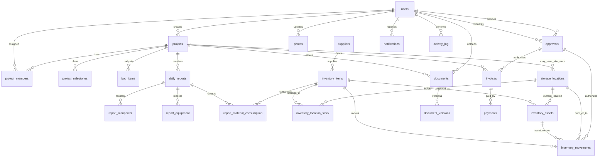

# PostgreSQL Schema Implementation Intent

This folder documents the intended PostgreSQL schema for the Construction Internal Portal. It is organized as one file per table so engineers can review relationships and implementation behavior without reading one long schema file.

The schema is designed for PostgreSQL 16 with UUID primary keys, soft deletes on user-facing records, audit logging, approval routing, document/media storage metadata, location-aware inventory, and project-level finance.

## Table Groups

| Area | Tables |
|---|---|
| Identity and access | [users](users.md) |
| Projects and planning | [projects](projects.md), [project_members](project_members.md), [project_milestones](project_milestones.md), [boq_items](boq_items.md) |
| Daily reporting | [daily_reports](daily_reports.md), [report_manpower](report_manpower.md), [report_equipment](report_equipment.md), [report_material_consumption](report_material_consumption.md) |
| Inventory and stores | [suppliers](suppliers.md), [storage_locations](storage_locations.md), [inventory_items](inventory_items.md), [inventory_location_stock](inventory_location_stock.md), [inventory_assets](inventory_assets.md), [inventory_movements](inventory_movements.md) |
| Documents and media | [documents](documents.md), [document_versions](document_versions.md), [photos](photos.md) |
| Workflow and communication | [approvals](approvals.md), [notifications](notifications.md) |
| Accounts and finance | [invoices](invoices.md), [payments](payments.md) |
| Governance | [activity_log](activity_log.md) |

## Relationship Map

## Cross-Cutting Rules

- Every table uses `id UUID PRIMARY KEY DEFAULT uuid_generate_v4()` unless noted.
- User-facing records use `deleted_at TIMESTAMPTZ` for soft delete where historical traceability matters.
- Records with mutable business state use `created_at` and `updated_at`.
- Approval-controlled records store the workflow in [approvals](approvals.md) and keep the business record immutable after approval unless an audited override is used.
- Files are stored in object storage; PostgreSQL stores metadata and object keys only.
- Inventory current location is warehouse/site only. Person and vehicle custody are intentionally out of scope for this version.
